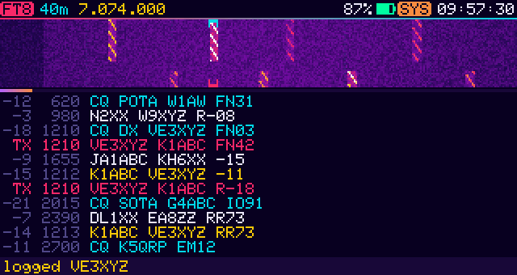
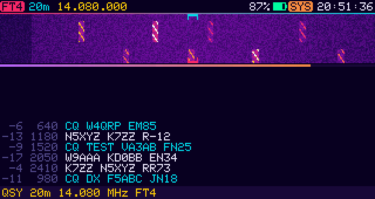
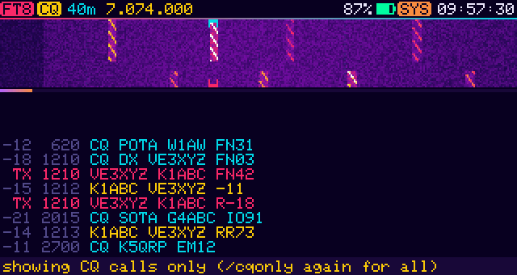
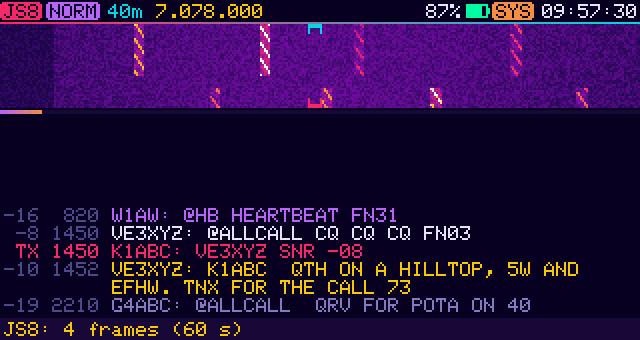
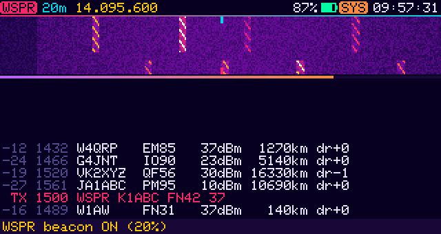
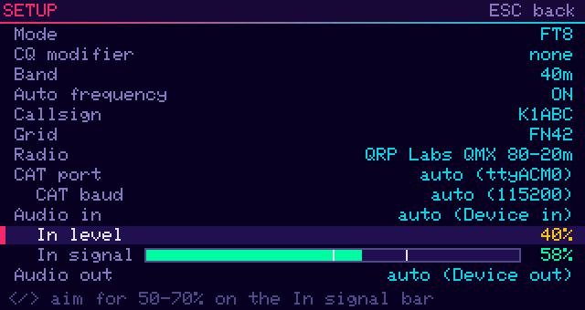

# Operating QSO-Zero

This guide covers setting QSO-Zero up the first time, how commands work, and what you can do in each mode. For installing and building, see the [README](README.md).

**Contents**
* [First-time setup](#first-time-setup)
* [The screen](#the-screen)
* [Keys](#keys)
* [How commands work](#how-commands-work)
* [Commands for every mode](#commands-for-every-mode)
* [FT8 and FT4](#ft8-and-ft4)
* [JS8](#js8)
* [WSPR](#wspr)
* [Radio, frequencies and audio](#radio-frequencies-and-audio)
* [Uploading the log to QRZ and Wavelog](#uploading-the-log-to-qrz-and-wavelog)
* [Saving settings](#saving-settings)
* [Logs and troubleshooting](#logs-and-troubleshooting)

---

## First-time setup

### 1. On the command line (once, after installing)

Install the package with `sudo apt update` followed by `sudo apt install ./qso-zero_<version>_arm64.deb`, so that its dependencies (`libhamlib-utils` for radio control, plus the sound and SSL libraries) come with it. If the install stopped with "dependency problems", `sudo apt install -f` finishes it. The [README](README.md#install-from-a-package) has the full requirements.

```sh
qso-zero-setup            # asks for your callsign and radio, writes ~/.config/qso-zero.conf,
                          # and adds you to the dialout, audio, video and input groups
sudo reboot               # the new groups take effect after a reboot (or log out and back in)
qso-zero-setup --check    # optional: shows what QSO-Zero will find (screen, keyboard, ports, sound cards)
```

Uploading QSOs to QRZ Logbook or Wavelog is optional; set it up any time with `qso-zero-setup --logbook` (see [Uploading the log](#uploading-the-log-to-qrz-and-wavelog)).

The radio names it asks for are `qmx`, `qmxplus`, `g90`, `x6100`, `x6200`, `ic705` and `ft891`. If the settings file already exists, `qso-zero-setup` leaves it alone and only checks the groups.

### 2. Connect the radio

Plug the radio's USB cable (or the Digirig) into the Cardputer Zero and turn the radio on. QSO-Zero finds the CAT port and the radio's USB sound card by itself.

### 3. In the app

Open **QSO-Zero** from the launcher. It opens in **Setup**, with the cursor on **Radio**, so choosing a different radio is one press of Enter away. (Every start opens here; **esc** goes to the main screen.) Until a callsign is set, the status line says *Welcome! Set your callsign: ESC > Callsign*.

In Setup, move with ↑ / ↓ (fn+F / fn+X) and change values with ← / → (fn+Z / fn+C) or **Enter**.

| Step | Setup item | What to do |
|---|---|---|
| 1 | **Callsign** | Enter opens the input line with `/call ` filled in. Type your call and press Enter. |
| 2 | **Grid** | Enter, then type your 4- or 6-character locator in capitals (`FN42` or `FN42HN`) and press Enter. With the GPS Cap, turn on **Grid from GPS** instead. |
| 3 | **Radio** | Enter shows the list. Pick your radio with ↑ / ↓ and press Enter. Changing the radio puts **CAT port** and **CAT baud** back on auto. There are three QMX entries, one per hardware version (80-20m, 60-15m and 20-10m): choose yours, because they look identical over CAT and only the right one keeps band changes to bands your QMX has filters for. Choosing any of them also sets **TX audio level** to 100%, because the QMX only keys up when its audio is above 80%. |
| 4 | **CAT port** | Leave on **auto**. If the radio isn't found, Enter shows every serial port with what it is. |
| 4a | **CAT baud** | **auto** uses the radio's usual rate (shown in brackets). If you've set a different CAT baud rate in the radio's menu, pick the same one here: 4800, 9600, 19200, 38400, 57600 or 115200. Changing the radio puts it back on auto. |
| 5 | **Audio in / Audio out** | Leave on **auto**: it picks the radio's USB sound card. |
| 6 | **In level** | Use ← / → until the **In signal** bar sits between the two white marks (50–70%) on a busy band. Red means it's clipping. |
| 7 | **Out level** and **TX audio level** | Start around 50% and adjust so the radio's ALC barely moves when you transmit. **Tune 10 s** sends a carrier you can check with. |
| 8 | **Save settings** | Writes everything to `~/.config/qso-zero.conf`. |

Press **esc** to go back to the main screen. QSO-Zero starts in **WSPR on 20 m**, which is a good first check: press **ctrl+W** to start beaconing and look yourself up on wsprnet.org after a few minutes.

**GPS (optional).** With the LoRa/GPS Cap fitted, QSO-Zero reads time and position from `/dev/serial0`. The clock chip in the header turns from orange **SYS** (system clock) to green **GPS** when locked. If the UART isn't enabled on your image, enable it and disable the serial console. Without GPS, the system clock is used. It needs to be within about a second of true time, so keep the Zero on the internet now and then or use GPS.

---

## The screen



* **Header:** mode chip (FT8, FT4, JS8, WSPR), extra chips (JS8 speed, **GN** for GHOSTNET, **A** for JS8 auto-reply, **CQ** for the CQ-only filter), band and dial frequency, battery, clock source (**GPS** or **SYS**) and UTC. **TX** shows while transmitting.
* **Waterfall:** the 0–3000 Hz audio passband. The cyan marker on top is your RX/TX offset.
* **Decode list:** SNR, audio frequency and message. **Cyan:** CQ calls. **Yellow:** messages to you. **Red, marked TX:** your own transmissions. **White:** everything else.
* **Status / input line:** messages from QSO-Zero, or what you're typing.

---

## Keys

On the Cardputer Zero's keyboard, **fn**, **sym** and **shift** can be held, tapped once (next key only) or tapped twice (locked). The arrows are on the fn layer. Symbols printed in blue (including `/`, `?`, `@` and `-`) are on the sym layer, exactly as the key legends show. A USB keyboard works with its normal layout.

### Main screen

| Key | Action |
|---|---|
| letters, digits, sym symbols | type a message or command |
| Enter | send what you typed. On an empty line: reply to the selected decode |
| Backspace | delete a character |
| fn+F / fn+X (↑ ↓) | select a decode. ↓ past the newest line goes back to live |
| fn+Z / fn+C (← →) | move the RX/TX audio offset by 10 Hz (hold shift: 100 Hz) |
| Tab | next mode: FT8 → FT4 → JS8 → WSPR. The decode list starts fresh |
| fn+L / fn+M (PgUp / PgDn), or ctrl+N / ctrl+P | band up / down (bands the radio can't do are skipped) |
| esc | clear the input line. Pressed again, it clears the selection, then opens Setup. **Hold 1 s: exit** |
| fn+1 (F1) | help screen |

### Anywhere

| Key | Action |
|---|---|
| ctrl+Q | call CQ (FT8, FT4, JS8) |
| ctrl+R | reply to the selected decode |
| ctrl+E | JS8 heartbeat |
| ctrl+W | WSPR beacon on / off (switches to WSPR) |
| ctrl+U | tune carrier for 10 s |
| ctrl+X | **halt transmit immediately** and stop any QSO, CQ or beacon |
| ctrl+T | Tools: GPS/time, radio, battery, audio and network status |

### Setup and pickers

| Key | Action |
|---|---|
| ↑ / ↓ | move |
| ← / → | change the value |
| Enter | edit or open the item |
| R (in a port or sound card list) | look again for devices |
| esc | back |

In **Tools**, U tunes for 10 s, W toggles the WSPR beacon, X halts TX, and + / − change the TX audio level.

---

## How commands work

Anything you type on the main screen is sent as a message in the current mode, **unless it starts with `/`**. A line that starts with `/` is a command for QSO-Zero and is never transmitted.

```
/command argument
```

* Type `/` with **sym** + the `/` key, then the command, a space, and the argument, then press **Enter**.
* Commands aren't case-sensitive (`/MODE FT4` = `/mode ft4`).
* Setup items that need typing (Callsign, Grid, CQ modifier, INFO, STATUS, APRS) fill in the command for you; just add the value and press Enter.
* Changes take effect straight away. Use `/save` (or Setup › **Save settings**) to keep them after a restart.
* An unknown command shows *unknown: … (try /help)*.

---

## Commands for every mode

| Command | Example | What it does |
|---|---|---|
| `/mode` (`/m`) | `/mode ft4` | switch mode: `ft8`, `ft4`, `js8`, `wspr` |
| `/band` (`/b`) | `/band 40` | go to a band: 160 80 60 40 30 20 17 15 12 10 6 |
| `/freq` (`/f`) | `/freq 7.074` | set the dial frequency in MHz |
| `/qsy` | `/qsy off` | automatic frequency on / off (see [below](#automatic-frequency)) |
| `/call` | `/call K1ABC` | set your callsign |
| `/grid` | `/grid FN42` | set your grid (turns off Grid from GPS) |
| `/rx`, `/tx` | `/rx 1500` | set the RX or TX audio offset in Hz |
| `/level` | `/level 40` | QSO-Zero's TX audio drive, in % |
| `/inlevel`, `/outlevel` | `/inlevel 45` | the sound card's receive / transmit level, in % |
| `/tune` | `/tune 5` | send a tune carrier for that many seconds (up to 30; plain `/tune` is 10) |
| `/port` | `/port /dev/ttyACM1` | CAT port (`/port auto` to go back to automatic) |
| `/baud` | `/baud 9600` | CAT baud rate: 4800, 9600, 19200, 38400, 57600, 115200 or `auto` (the radio's usual rate) |
| `/ain`, `/aout` | `/ain plughw:CARD=Device,DEV=0` | sound card for receive / transmit (`auto` for automatic) |
| `/rescan` | `/rescan` | look for sound cards again and reconnect |
| `/net` | `/net` | check the internet now and send any waiting WSPR spots |
| `/upload` | `/upload` | upload waiting QSOs to QRZ / Wavelog now and show what has been sent (if set up) |
| `/save` | `/save` | save settings |
| `/help` | `/help` | help screen |
| `/quit` | `/quit` | exit |

---

## FT8 and FT4

FT8 uses 15-second cycles and FT4 uses 7.5-second cycles. Otherwise they work the same way: the same messages, keys and commands. FT4 isn't used on 160 m or 60 m, so QSO-Zero says so if you switch to FT4 on those bands.



### Making a contact

**Answer a station.** Select its line with ↑ / ↓ and press **Enter** (or ctrl+R). Usually you'll pick a CQ, but you can also select a station that's finishing a QSO. QSO-Zero sends `THEIRCALL YOURCALL GRID` in the opposite slot to theirs and runs the rest of the QSO:

```
CQ W1AW FN31                they call CQ
W1AW K1ABC FN42             you answer (Enter on their line)
K1ABC W1AW -11              they send your report
W1AW K1ABC R-15             QSO-Zero sends theirs, with R        ← automatic
K1ABC W1AW RR73             they confirm
W1AW K1ABC 73               QSO-Zero signs off and logs the QSO  ← automatic
```

**Call CQ.** Press **ctrl+Q** (or `/cq`). QSO-Zero calls `CQ YOURCALL GRID` in the even slots. The first station to answer gets the auto-sequence through to 73.

**Type a call yourself.** Typing a standard message to a station you've heard (for example `W1AW K1ABC FN42`) also starts the auto-sequence with them. A message to a station you haven't heard is sent once, as typed.

**Repeats and giving up.** If the other station doesn't answer, QSO-Zero repeats the last message, up to 6 times for a call (10 for CQ), then stops and says so.

**Stopping.** **ctrl+X** stops transmitting immediately and ends the QSO.

**Logging.** The QSO is logged when you send RR73 or 73, to `~/qso-zero/qso-zero.adi`. The file is standard ADIF: import it into your logbook or LoTW software. FT4 is logged as `MFSK` with submode `FT4`.

**Messages to you outside a QSO** are shown in yellow but not answered automatically. Select one and press Enter to answer.

### Messages you can type

| Message | Meaning |
|---|---|
| `CQ K1ABC FN42` | CQ (ctrl+Q builds it for you) |
| `CQ POTA K1ABC FN42` | CQ with a modifier |
| `W1AW K1ABC FN42` | call W1AW |
| `W1AW K1ABC -12` | send a report |
| `W1AW K1ABC R-12` | report and acknowledgement |
| `W1AW K1ABC RR73` / `RRR` | confirm |
| `W1AW K1ABC 73` | sign off |
| `TNX 73 GL` | free text: up to 13 characters of A–Z, 0–9, space and `+ - . / ?` |

A message that can't be sent shows *not a valid FT8 message* (or FT4).

### FT8 / FT4 commands

| Command | Example | What it does |
|---|---|---|
| `/cq` | `/cq` | call CQ (same as ctrl+Q) |
| `/cqmod` | `/cqmod POTA` | CQ modifier: 1–4 letters or 3 digits; `/cqmod` alone for none |
| `/cqonly` (`/filter`) | `/cqonly` | show only CQ calls; again to show everything. `/cqonly on` and `/cqonly off` also work |

**CQ modifier.** Setup › **CQ modifier** steps through none, DX, POTA, SOTA and QRP; press Enter to type your own. The modifier can be 1 to 4 letters or exactly 3 digits (`CQ 290`). That limit comes from the FT8 message format itself, so anything else is refused.

**CQ-only filter.**



* While it's on, the list shows only CQ calls, plus messages to you and your own transmissions, so a QSO in progress stays visible. A **CQ** chip shows in the header.
* ↑ / ↓ step from CQ to CQ.
* Nothing is deleted: turn the filter off and every decode is back.

### Decode timing

Each cycle is decoded twice. The **early pass** runs right after the last on-time signal ends (13.35 s into an FT8 cycle, 5.65 s for FT4), so decodes appear about 0.6 s sooner. The **final pass** at 14.0 s (FT8) or 5.9 s (FT4) adds stations whose clocks run a little late. On the Cardputer Zero a busy band takes about 400 ms to decode.

Your own transmission, if the radio returns it over USB (the X6200 does), is shown only once, as sent, never as a received decode.

---

## JS8

JS8 is keyboard-to-keyboard chat. QSO-Zero's JS8 is a port of JS8Call and talks to JS8Call stations directly.



### Sending

Type a message the way you would in JS8Call and press Enter:

| You type | Sends |
|---|---|
| `W1AW HELLO FROM THE PARK` | a directed message to W1AW |
| `W1AW SNR?` | ask W1AW for your signal report (also `GRID?`, `INFO?`, `STATUS?`, `HEARING?`) |
| `@ALLCALL QRV ON 40M` | a message to everyone |
| `CQ CQ CQ FN42` | CQ (ctrl+Q builds it for you) |
| `@HB HEARTBEAT FN42` | heartbeat (ctrl+E builds it for you) |

Long messages are split into several frames; the status line shows how many and how long they'll take. Received messages build up on one line as their frames arrive.

**Decode timing.** Each JS8 period is decoded 0.35 s after an on-time transmission ends. At **Fast** and **Turbo**, a second pass about a second later picks up frames from stations whose clocks run late. Frames already decoded aren't added twice, so a message spread over several periods is still joined in order on one line. (At Normal and Slow the first pass already copies stations up to about 2 seconds late, so there's no second pass.) Each period's timing is in the activity log as a `[decode] JS8 …` line.

To reply to a station, select its line and press Enter: QSO-Zero fills in their callsign and moves to their audio frequency.

### JS8 commands

| Command | Example | What it does |
|---|---|---|
| `/sub` | `/sub fast` | speed: `normal`, `fast`, `turbo`, `slow` (also Setup › JS8 speed) |
| `/hb` | `/hb` | send a heartbeat (same as ctrl+E) |
| `/auto` | `/auto on` | automatic replies on / off |
| `/hback` | `/hback on` | acknowledge heartbeats (needs `/auto on`) |
| `/info` | `/info QMX 5W EFHW` | your reply to `INFO?` |
| `/status` | `/status PORTABLE, QRV 40M` | your reply to `STATUS?` |
| `/ghost` | `/ghost 40` | GHOSTNET on 80, 40 or 20 m; `/ghost off` to leave |
| `/aprspos` | `/aprspos` | send your position to APRS |
| `/aprs` | `/aprs W1AW-7 QRV 7.078` | APRS message to a station |
| `/sms` | `/sms 5551234567 ARRIVED OK` | text a phone through APRS |
| `/email` | `/email me@example.com ON SUMMIT` | email through APRS |

### Automatic replies

Turn on with **Setup › JS8 auto-reply** or `/auto on`. An **A** chip shows in the header. QSO-Zero then answers queries addressed to your callsign, the same way JS8Call does:

| Query to your call | Reply |
|---|---|
| `SNR?` | `CALL SNR -08` |
| `GRID?` | `CALL GRID FN42` |
| `INFO?` / `STATUS?` | your INFO / STATUS text (no reply if it's blank) |
| `HEARING?` | up to 4 stations heard in the last hour |
| `AGN?` | repeats your last transmission |
| `MSG …` | checks it, saves it to `~/qso-zero/js8/qso-zero-inbox.txt`, replies `ACK` |
| `@HB` heartbeat | `CALL HEARTBEAT SNR -12`, only with **JS8 heartbeat ACK** on, at most once per station every 15 minutes |

It never answers while you have something queued or are transmitting, or after ctrl+X. Each reply shows on screen as `AUTO-REPLY queued: …`.

### GHOSTNET

GHOSTNET runs JS8 on its own frequencies: **3.575 MHz (80 m), 7.107 MHz (40 m) and 14.107 MHz (20 m)**.
* In Setup, press Enter on one of the three frequencies, or type `/ghost 40`. QSO-Zero switches to JS8 and tunes there.
* After that the VFO is yours. Nets sometimes move to avoid interference, so QSO-Zero won't pull you back, and it remembers where you tuned on each band.
* While GHOSTNET is on, the band keys cycle 80 → 40 → 20 m.
* `/ghost off` returns to the normal JS8 frequencies.

### APRS over JS8

Messages to the **@APRSIS** group are relayed into APRS by any JS8Call station that hears you and has APRS reporting on. QSO-Zero formats them for APRS and adds a checksum, so a damaged copy is dropped.
* Someone has to hear and relay you. There's no acknowledgement over JS8, so check aprs.fi or ask for a reply.
* **SMS** goes through the SMS gateway. The phone number must be registered at aprs.wiki first.
* **Email** goes through EMAIL-2, and is meant for interactive use only.
* JS8 sends capitals only, so texts and emails arrive in capitals.

---

## WSPR

WSPR is a beacon mode: you send your callsign, grid and power every few minutes, and stations worldwide report hearing you to wsprnet.org. QSO-Zero also decodes other beacons.



* **Beacon on / off:** ctrl+W or `/wspr`. It transmits in 2-minute slots, in **WSPR TX %** of them (20% by default, about one in five).
* **Power:** Setup › **WSPR power** or `/pwr 37`. This is the power you *report*, in dBm (37 dBm = 5 W, 30 = 1 W, 23 = 200 mW). Set it to what the radio actually puts out.
* **Receive:** Setup › **WSPR receive**. Spots show callsign, grid, power, distance from you and drift.
* **Uploads:** when the Zero is online, spots go to wsprnet.org every 5 minutes. With no internet they're dropped rather than saved up. `/net` checks now.
* **Callsign:** WSPR needs a plain callsign (no `/P` or prefixes), and it must be set; spots are never sent as N0CALL.

| Command | Example | What it does |
|---|---|---|
| `/wspr` | `/wspr` | beacon on / off (same as ctrl+W) |
| `/pwr` | `/pwr 23` | reported power in dBm, rounded to a WSPR value (0, 3, 7, 10, 13 … 60) |
| `/net` | `/net` | check wsprnet now |

---

## Radio, frequencies and audio

### Automatic frequency

With **Auto frequency** on (the default), changing mode or band tunes the radio to that mode's usual frequency:

| Band | FT8 | FT4 | JS8 | WSPR (dial) |
|---|---|---|---|---|
| 160 m | 1.840 | — | 1.842 | 1.8366 |
| 80 m | 3.573 | 3.575 | 3.578 | 3.5686 |
| 60 m | 5.357 | — | 5.357 | 5.2872 |
| 40 m | 7.074 | 7.0475 | 7.078 | 7.0386 |
| 30 m | 10.136 | 10.140 | 10.130 | 10.1387 |
| 20 m | 14.074 | 14.080 | 14.078 | 14.0956 |
| 17 m | 18.100 | 18.104 | 18.104 | 18.1046 |
| 15 m | 21.074 | 21.140 | 21.078 | 21.0946 |
| 12 m | 24.915 | 24.919 | 24.922 | 24.9246 |
| 10 m | 28.074 | 28.180 | 28.078 | 28.1246 |
| 6 m | 50.313 | 50.318 | 50.318 | 50.293 |

* Turning the radio's VFO onto another band is noticed within about 2 seconds, and QSO-Zero follows. Tuning within a band is left alone.
* The frequency never changes while transmitting.
* Turn it off with Setup › **Auto frequency** or `/qsy off`; the band display then just follows the radio.
* To limit band stepping to some bands, put `bands = 40,30,20` in the settings file.

### USB-Digital mode

For every digital mode, QSO-Zero puts the radio in its data mode with a 3 kHz passband (USB-D, U-DIG or DATA-U, depending on the radio) and reads it back to check. A radio without a data mode (such as the G90) gets USB at the widest passband it accepts. You don't need to set the mode on the radio.

**Yaesu FT-891 with a Digirig DR-891:** the DR-891 passes the radio's own USB port through, so CAT and PTT both go over it (PTT is CAT, not RTS). In the radio's menu (hold **F**), set:
* **05-06 CAT RATE: 9600** (QSO-Zero's default for the FT-891; if you use another rate, pick it in **CAT baud**)
* **05-08 CAT RTS: DISABLE**
* **08-09 DATA IN SELECT: REAR** and **08-12 DATA BFO: USB**

Auto picks the radio's **Enhanced** serial port (`…CP2105…-if00`), even with an older Digirig Mobile plugged in too. With a Digirig Mobile, connect the radio's own USB cable for CAT as well.

**Icom IC-705:** set **DATA MOD** to **USB** on the radio (*MENU › SET › Connectors › MOD Input › DATA MOD*), so that in USB-D the transmit audio comes from the Cardputer. Leave the CI-V address at A4h and *CI-V USB Echo Back* OFF (the defaults). The IC-705 hasn't been tested with QSO-Zero yet.

**QRP Labs QMX:** QSO-Zero runs the QMX in its **USB** (SSB) mode for all digital modes, because FT8 decoded only in that mode, not in the QMX's Digi mode, in testing. Some settings in the QMX's own **SSB** menu make that work fully. They're stored in the radio, so they only need setting once, and QSO-Zero can't set them over CAT, so when you choose a QMX in Setup a flashing box reminds you for 30 seconds (esc closes it):
* **Filter RX and Filter TX: 3200 Hz** (the default is 2700). Filter RX gives the full receive passband, so you see more stations; Filter TX lets the whole transmit audio range through. The QMX doesn't report these over CAT, so QSO-Zero can't check them either.
* **SSB Input: USB or Auto**, so transmit audio comes from the Cardputer rather than the microphone. (Auto switches to USB audio whenever a transmission is started over CAT, which is how QSO-Zero transmits.)

### Choosing the radio, port and sound cards

Setup has pickers for **Radio**, **CAT port**, **CAT baud**, **Audio in** and **Audio out**. Press Enter on one to see what's plugged in right now, pick with ↑ / ↓ and press Enter. Changes take effect straight away; use Save settings to keep them.
* **auto** (the default) finds the radio by its USB ID and uses its USB sound card. It never picks the Cardputer's built-in audio.
* **CAT baud** has to match the CAT baud rate set in the radio's own menu. The usual rates are: QMX 115200, X6100 / X6200 / G90 / IC-705 19200, FT-891 9600.
* The X6100 and X6200 have CAT on their second USB serial interface; auto finds it. The IC-705 has CAT on its first (`…IC-705…-if00`); its second carries GPS / RTTY data.
* After plugging the radio in while QSO-Zero is running, use Setup › **Rescan audio** (or `/rescan`).

### Levels

| Setting | What it is |
|---|---|
| **In level** | the sound card's receive level. Set it with the **In signal** bar: 50–70% is right, yellow is hot, red is clipping |
| **Out level** | the sound card's transmit level |
| **TX audio level** | QSO-Zero's own drive, on top of Out level. Adjust so the radio's ALC barely moves |

Some sound cards have no level controls for Linux to adjust: the QRP Labs QMX, for example. In level and Out level then show **n/a**; set the levels in the radio's own menu, and use the **In signal** bar and **TX audio level** as usual.

Stereo sound cards such as the QMX's are handled automatically: QSO-Zero records both channels and uses one, and the activity log shows each channel's level when receiving starts.



---

## Uploading the log to QRZ and Wavelog

Every QSO is written to the ADIF log, `~/qso-zero/qso-zero.adi`. QSO-Zero can also send each QSO to **QRZ Logbook**, to **Wavelog** (hosted or on your own network), or to both. This is optional; without it nothing leaves the Zero. Both have been tested on the air with QSO-Zero.

The ADIF log is only read for uploads. It is never changed or deleted, so it stays a complete record of every contact, including for checking duplicates later.

### Setting it up

Over SSH (the settings are typed, so this is easier from a computer):

```sh
qso-zero-setup --logbook
```

It asks for:

* **QRZ Logbook API key.** On qrz.com: *My Logbook › Settings › API*, for the logbook of the callsign you log as. Uploading through the API needs a QRZ subscription (XML Data or higher).
* **Wavelog URL**, for example `https://log.example.com`. Give only the base address; `/index.php/api/qso` is added for you.
* **Wavelog API key.** In Wavelog: your callsign menu (top right) › *API Keys* › create a **read+write** key.
* **Wavelog station location.** The setup lists the station locations that key can see; pick the one whose callsign matches yours.
* For each service, whether to **upload automatically** after every QSO. If you say no, QSOs wait until you run `qso-zero-setup --upload`.

Press Enter to keep a setting, or type `-` to remove it. The setup then checks the keys. If your log already has QSOs, it asks whether to upload them now. Answering **No** marks them as already uploaded, so only new QSOs are sent.

The settings go in `~/.config/qso-zero-logbook.conf`, which only you can read. A running QSO-Zero picks up changes within 5 minutes, or right away with `/upload`.

### How uploads work

* A QSO is uploaded as soon as it's logged. QSOs logged with no internet wait, and are sent on the next try (every 5 minutes, after the next QSO, or with `/upload`).
* Each service gets each QSO once. What was sent is recorded in `~/qso-zero/uploads/qrz.txt` and `wavelog.txt`, one line per QSO (call, date, time, band, mode, then *sent*, *dupe*, *rejected* or *skipped*).
* If QRZ or Wavelog already has the QSO, it's recorded as a duplicate and not sent again.
* A QSO the service **rejects** (for example, Wavelog's station callsign doesn't match) isn't retried automatically. Fix the cause, then run `qso-zero-setup --upload` to try again.
* If a key is refused or the server can't be reached, nothing is marked as sent. The QSOs stay waiting, and the reason appears in `/upload` and in the activity log (`[logbook]` lines).
* The keys only travel over HTTPS, with the server's certificate checked. The exception is a Wavelog URL you give as `http://`, for a server on your own network; the setup warns about it.

### Commands

```sh
qso-zero-setup --logbook          # set up, change or remove QRZ / Wavelog
qso-zero-setup --upload           # send everything waiting, and retry rejected QSOs
qso-zero-setup --upload qrz       # ... only to QRZ (or: wavelog)
qso-zero --logbook status         # per service: QSOs in the log, waiting, rejected
qso-zero --logbook test           # check the keys (and the Wavelog station location)
qso-zero --logbook stations       # list the Wavelog station locations for your key
qso-zero --logbook mark qrz       # treat every QSO now in the log as already uploaded
```

---

## Saving settings

**Save settings** (or `/save`) writes `~/.config/qso-zero.conf`. That covers your callsign, grid, radio, ports and sound cards, levels, CQ modifier, CQ-only filter, WSPR power and TX %, JS8 auto-reply settings, GHOSTNET and Auto frequency. Changes you don't save last until you exit.

Every start opens in **WSPR on 20 m**. The settings file is plain text and has comments, so you can also edit it by hand while QSO-Zero isn't running.

---

## Logs and troubleshooting

```sh
qso-zero-setup --log        # the last 150 lines of the activity log
qso-zero-setup --log all    # all 5 kept logs, oldest first
qso-zero-setup --check      # what QSO-Zero finds: screen, keyboard, ports, sound cards, permissions
qso-zero --nohw             # run without radio, audio or GPS
qso-zero --bench            # time the decoders on this device
qso-zero --logbook status   # QRZ / Wavelog: what has been uploaded and what is waiting
```

The activity log (`~/.cache/qso-zero/qso-zero.log`) records the radio connection, each frequency and mode change, the sound cards, every transmission, every decode cycle (`[decode]`) and every step of an FT8/FT4 QSO (`[seq]`, including why a message was ignored). Once a minute it adds a health line. Only the 5 newest logs are kept, at most 1 MB each.

| Problem | Try |
|---|---|
| *radio not connected* | Check the cable and that the radio is on. Setup › CAT port: pick the port by name. Setup › CAT baud: the same rate as the radio's CAT baud menu. |
| No decodes, waterfall dark | Setup › Audio in, then Rescan audio. Check the In signal bar moves. |
| Few decodes, In signal red | Turn **In level** down until the bar is 50–70%. |
| Decodes but nobody answers | Check the clock chip (green GPS, or SYS with internet time), TX audio level and ALC, and that the radio is transmitting. |
| *not a valid FT8 message* | Check the message forms in [Messages you can type](#messages-you-can-type). |
| Transmitting and need to stop | **ctrl+X**. Holding **esc** exits the app, which also stops transmitting. |

When reporting a problem, send the output of `qso-zero-setup --log all`.
