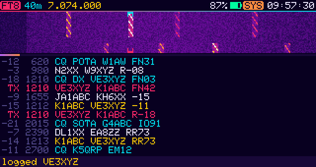
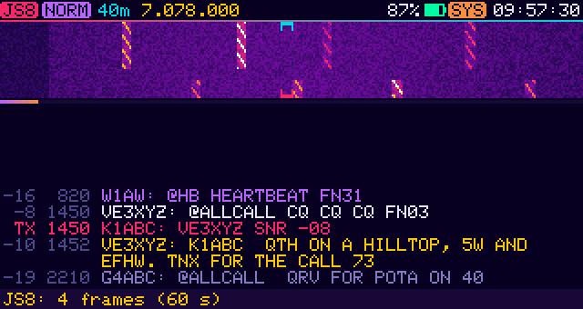
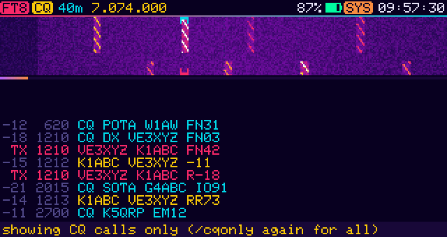
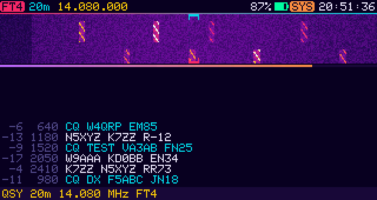
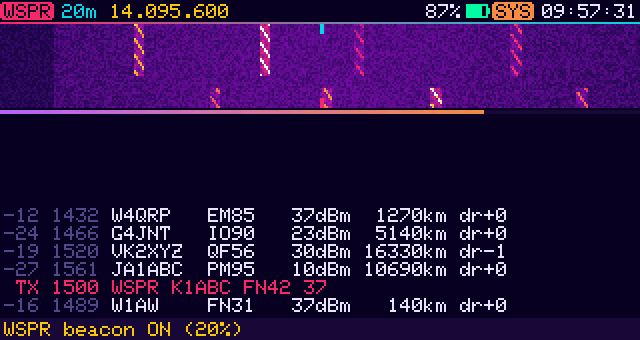
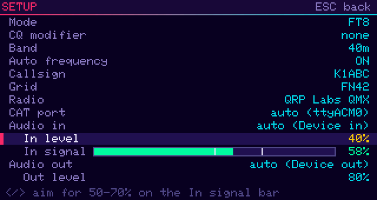
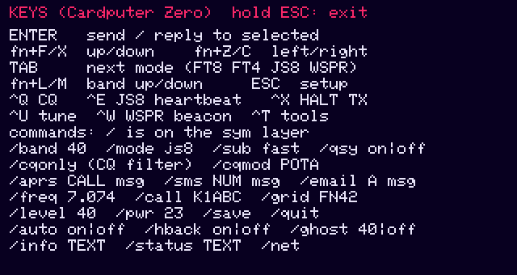
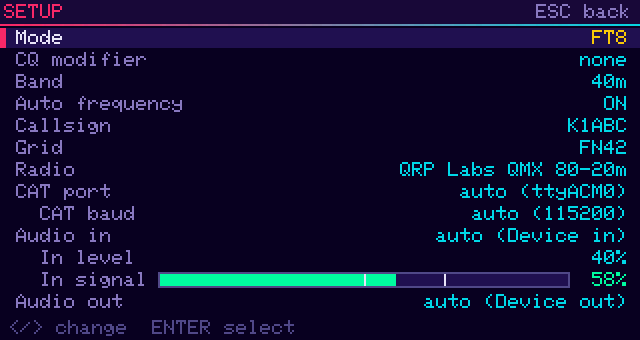
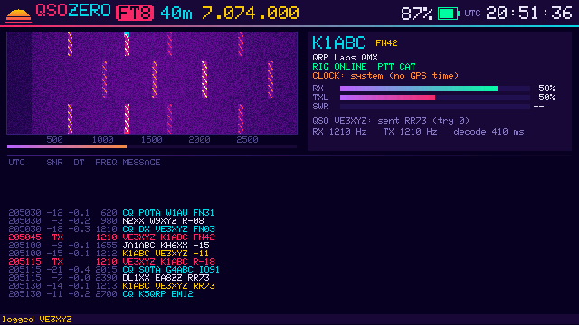

# QSO-Zero

A pocket FT8 / FT4 / JS8 / WSPR station for the **M5Stack Cardputer Zero**, built for QRP operators in the field. It's plain C with no desktop: it draws straight to the Cardputer's screen, controls the radio through Hamlib, and decodes and transmits on its own. No PC needed.

> **Alpha software.** QSO-Zero is in active development and has been on the air with a Xiegu X6200. Expect rough edges, and send the activity log (`qso-zero-setup --log all`) with any problem report.

<p>
  
  
</p>

## What it does

* **FT8 and FT4:** decode, call CQ, answer stations, and run the whole QSO automatically (report, R-report, RR73, 73). Each QSO is logged to an ADIF file.
* **JS8:** a native port of JS8Call that works with JS8Call stations. All four speeds, heartbeats, directed messages, free text, optional automatic replies, GHOSTNET and APRS messaging.
* **WSPR:** beacon to see how far you're heard, and decode other beacons with distance to each one. Spots upload to wsprnet when you're online.
* **Rig control:** puts the radio on the right frequency and in USB-Digital mode, and keys PTT over CAT.
* **GPS time and grid** from the LoRa/GPS Cap, so it works with no internet.
* **HDMI:** switches to a large layout when a monitor is plugged in.

The full operating guide, with first-time setup and every command, is in **[Operations.md](Operations.md)**.

## Screenshots

| | |
|---|---|
|  **FT8.** CQ calls in cyan, messages to you in yellow, your transmissions in red. |  `/cqonly` shows only CQ calls, plus your own QSO. |
|  **FT4.** The same QSO flow on 7.5-second cycles. |  Directed messages, heartbeats and free text. |
|  **WSPR.** Spots with distance, and your beacon. |  The *In signal* bar helps you set the receive level. |
|  **fn+1** shows the keys and common commands. |  **Setup** (esc). Options for the current mode are listed first. |

On an HDMI monitor:



*The screenshots use example callsigns.*

## Supported radios

| Radio | `radio =` | Connection | Bands |
|---|---|---|---|
| QRP Labs QMX | `qmx` | one USB cable (CAT + audio) | 80–10 m |
| QRP Labs QMX+ | `qmxplus` | one USB cable | 160–6 m |
| Xiegu G90 | `g90` | Digirig (CAT + audio) | 160–10 m |
| Xiegu X6100 | `x6100` | built-in USB | 160–6 m |
| Xiegu X6200 | `x6200` | built-in USB | 160–6 m |
| Yaesu FT-891 | `ft891` | Digirig (CAT + DATA jack), PTT on RTS | 160–6 m |

QSO-Zero finds the radio's CAT port and USB sound card by itself. You can also pick them in Setup.

Even with the defaults, you may need to set the correct paths yourself, for example when the radio has more than one serial port or another USB device is plugged in. Check that Setup shows your radio's port under **CAT port** (the X6100 and X6200 use their second port, `/dev/ttyACM1`, shown as `…-if02`) and its sound card under **Audio in** and **Audio out** (usually `plughw:CARD=Device,DEV=0`). The `[rig]` and `[audio]` lines from `qso-zero-setup --log` show which paths were used.

## Install from a package

Each release on the **[Releases page](../../releases/latest)** has two packages. The Cardputer Zero uses **arm64**; armhf is for 32-bit Raspberry Pi OS. On the device, `dpkg --print-architecture` tells you which you need.

### Requirements

* **Raspberry Pi OS Bookworm or newer** (or another Debian 12+ based image). The package needs `libc6` 2.34 or newer; `ldd --version` shows yours.
* An **internet connection during the install**, so `apt` can fetch the dependencies.

`apt` and the Cardputer Zero launcher / store install these for you:

| Package | Why | |
|---|---|---|
| `libhamlib-utils` | `rigctld`, which QSO-Zero uses to control the radio | required |
| `libasound2` (`libasound2t64` on newer images) | the sound cards: receive and transmit audio | recommended, installed by default |
| `libssl3` (or `libssl1.1`) | HTTPS uploads to wsprnet; plain HTTP is used without it | recommended, installed by default |

### Installing

**On the Cardputer Zero** (with the package downloaded to it):

```sh
sudo apt update                                 # refresh the package lists first, especially on a new unit
sudo apt install ./qso-zero_0.2.7_arm64.deb     # keep the ./ - this also installs libhamlib-utils
sudo systemctl restart APPLaunch.service        # show the new app in the launcher now
qso-zero-setup                                  # first time only: callsign, radio, permissions
sudo reboot                                     # first time only: applies the permissions
```

Then open **QSO-Zero** from the launcher. To exit, **hold esc for one second**.

**From your computer over SSH:**

```sh
scp qso-zero_0.2.7_arm64.deb pi@<device-ip>:/tmp/
ssh pi@<device-ip> 'sudo apt update && sudo apt install -y /tmp/qso-zero_0.2.7_arm64.deb && sudo systemctl restart APPLaunch.service'
```

**If the install stops with "dependency problems"** and leaves QSO-Zero unconfigured (this happens with `dpkg -i`, which doesn't download dependencies, or when the package lists are out of date), finish it with:

```sh
sudo apt update
sudo apt install -f        # installs the missing dependencies and finishes configuring QSO-Zero
```

If `apt` still refuses, check the OS version with `cat /etc/os-release`: images older than Bookworm can't run this package.

**Updating:** install the new package the same way. Your settings (`~/.config/qso-zero.conf`) and your QSO log (`~/qso-zero/qso-zero.adi`) are in your home folder, so updates and even uninstalling leave them alone.

**Uninstalling:** `sudo apt remove qso-zero`.

Every push to `main` also publishes test packages on the [`packages` branch](../../tree/packages).

## Quick start

First-time setup is covered step by step in [Operations.md](Operations.md#first-time-setup). In short: **esc** opens Setup; set **Callsign**, **Grid** and **Radio**, and choose **Save settings**.

1. **Set the receive level.** In Setup, select **In level** and use ← / → until the **In signal** bar sits between the two white marks (50–70%).
2. **See how far you're heard.** QSO-Zero starts in WSPR on 20 m. **ctrl+W** turns the beacon on, and the spots appear on wsprnet.
3. **Make an FT8 contact.** Press **Tab** to get to FT8. Select a station's CQ with ↑ / ↓ and press **Enter**. QSO-Zero calls them and finishes the QSO on its own. **ctrl+Q** calls CQ yourself instead.
4. **Stop transmitting** at any time with **ctrl+X**.
5. **Chat on JS8.** Press Tab until JS8, then type a message such as `W1AW HELLO FROM THE PARK` and press Enter.

### Essential keys

| Key | Does |
|---|---|
| fn+F / fn+X (↑ ↓) | select a decode; move in Setup |
| fn+Z / fn+C (← →) | move the audio offset 10 Hz (with shift: 100 Hz); change a Setup value |
| Enter | send what you typed, or reply to the selected decode |
| Tab | next mode: FT8 → FT4 → JS8 → WSPR |
| fn+L / fn+M | band up / down |
| ctrl+Q | call CQ (FT8, FT4, JS8) |
| ctrl+W | WSPR beacon on / off |
| ctrl+X | **halt transmit now** |
| esc | back, or open Setup. **Hold 1 s to exit** |
| fn+1 | help |

Every key and command is in [Operations.md](Operations.md#keys).

## Build from source

On the Cardputer Zero or any Debian / Raspberry Pi OS machine:

```sh
sudo apt install build-essential libhamlib-utils
git clone https://github.com/CzarD0mn/QSO-Zero.git
cd QSO-Zero
make -j4               # builds build/qso-zero
make test              # optional: the test suite, about 3 minutes
build/qso-zero --nohw  # try the interface without a radio
```

`sudo make install` installs to `/usr/local`. Building a package (next section) is usually easier, because the package also sets up the launcher entry and permissions.

## Build a package

**On the Cardputer Zero (or another Pi):** this builds a package for the machine's own architecture.

```sh
make -j4
make deb                         # -> build/qso-zero_0.2.7_arm64.deb
make deb VERSION=0.2.8~test1     # a test build with its own version number
```

Install it with `sudo apt install ./build/qso-zero_<version>_<arch>.deb`.

**On a Linux PC with Docker:** QEMU emulates the Cardputer's processor, the same way the GitHub build does. Run this from the source folder:

```sh
docker run --privileged --rm tonistiigi/binfmt --install arm64    # once, to enable ARM emulation
docker run --rm --platform linux/arm64 -v "$PWD":/src -w /src debian:bookworm sh -ec '
  apt-get update -qq
  apt-get install -y -qq --no-install-recommends build-essential binutils >/dev/null
  make -j"$(nproc)" && make deb'
```

The package lands in `build/`. Use `--platform linux/arm/v7` for armhf. Emulation is slow: allow 10–15 minutes.

**On GitHub:** every push to `main` builds and tests both packages. When the `version` in [`app-builder.json`](app-builder.json) changes, the build also creates a GitHub Release `vX.Y.Z` with the packages attached.

## Files

| What | Where |
|---|---|
| Settings | `~/.config/qso-zero.conf` (written by **Save settings** or `/save`) |
| QSO log (ADIF) | `~/qso-zero/qso-zero.adi` (the folder is created automatically) |
| Activity log | `~/.cache/qso-zero/qso-zero.log`; the 5 newest are kept. View with `qso-zero-setup --log` |
| JS8 message inbox | `~/qso-zero/js8/qso-zero-inbox.txt` (the folder is created automatically) |

## Adding a radio

Radio profiles are in `src/rig/radios.c`. Each new radio needs:

* **Hamlib model,** with a fallback model for older Hamlib if needed.
* **CAT serial hint, default port and baud,** and `@ifNN` if CAT isn't the first USB interface.
* **Sound card hint** and **band coverage.**
* **Data mode (required):** set `data_mode = "PKTUSB"` (Hamlib's name for USB-D, U-DIG, DATA-U and PKT-U), so the radio runs in USB-Digital for every digital mode. If the radio has no data mode, QSO-Zero automatically falls back to USB at the widest passband it accepts. Use plain `"USB"` only for a radio that misbehaves when asked for PKTUSB, with a comment saying why.

Then add the radio's `/dev/serial/by-id` names and `/proc/asound` listing to `tests/test_devices.c`, and check the `[rig] mode …` line in `qso-zero-setup --log` with the real radio.

## How it's tested

`make test` runs 14 test programs:
* **JS8:** bit-exact with JS8Call's encoder over 20,000 random frames.
* **FT8 and FT4:** over-the-air round trips.
* **WSPR:** symbols identical to JTEncode, and 5/5 copy down to −28 dB.
* **Real time:** decoding through the live audio path, the early decode pass, and a full auto-sequenced QSO.
* **App behaviour:** keyboard handling with the Cardputer Zero's real keymap, the CQ filter, the radio frequency and mode commands against a fake rigctld, sound card detection from real device listings, wsprnet upload, and log rotation.

`qso-zero --bench` times every decoder on the device itself. On the Cardputer Zero, an FT8 decode of a busy band takes about 400 ms.

## Known limits

* No PSKReporter upload yet (WSPR spots go to wsprnet).
* The FT8 decoder (ft8_lib) is about 2–3 dB less sensitive than WSJT-X.
* JS8 relays (`>`), `MSG TO:` store-and-forward and `QUERY MSG` retrieval are not automated.
* Holding an arrow key doesn't repeat; press it once per step.

## Licence

GPL-3.0-or-later. The JS8 modem and message layer are ports of JS8Call. Bundled: ft8_lib (MIT, Karlis Goba YL3JG), kissfft (BSD) and wsprd (GPLv3, K1JT/K9AN, C version by VA2GKA). `data/js8.jsc` is generated from JS8Call's dictionary by `tools/gen_jsc.py`.
